<p align="center">
  
</p>

<p align="center">
  
  
  
  
  
  
  
</p>

<p align="center">
  <a href="#what-it-does">What it does</a> &nbsp;·&nbsp;
  <a href="#the-algorithms">Algorithms</a> &nbsp;·&nbsp;
  <a href="#one-allocation-run">Allocation pipeline</a> &nbsp;·&nbsp;
  <a href="#measured-not-claimed">Benchmarks</a> &nbsp;·&nbsp;
  <a href="#architecture">Architecture</a> &nbsp;·&nbsp;
  <a href="#run-it-locally">Run it</a> &nbsp;·&nbsp;
  <a href="#api">API</a> &nbsp;·&nbsp;
  <a href="#testing">Testing</a>
</p>

<br>

**ChargeWise** is a full-stack platform for allocating EV charging infrastructure. Drivers request charging windows
for their vehicles; network operators run allocation over the whole queue. Behind every decision sit four classic
algorithms, **implemented from scratch in Java with no algorithm libraries**:

- **bipartite matching** assigns requests to compatible connectors
- **Edmonds-Karp maximum flow** shares grid power across sessions without breaking a single physical limit
- **randomized Quickselect** reports waiting-time and demand percentiles
- **a segment tree** answers slot-range capacity queries

Each algorithm runs next to a simpler **baseline** on identical input and is checked by an **independent verifier**,
so every claim the application makes about optimality is something you can watch it prove.

<p align="center">
  
</p>

## What it does

<p align="center">
  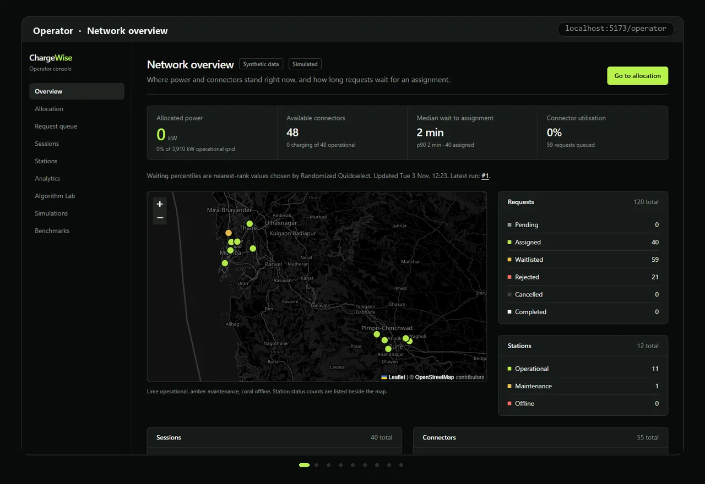
</p>

<table>
  <tr>
    <th width="50%" align="left">Driver portal</th>
    <th width="50%" align="left">Operator console</th>
  </tr>
  <tr valign="top">
    <td>
      <b>Garage.</b> Register vehicles with battery size, state of charge, connector types and maximum charging power.<br><br>
      <b>Find a station.</b> Map and list of stations, with per-connector compatibility for the selected vehicle and
      free compatible connectors per 15-minute slot.<br><br>
      <b>Request a window.</b> Energy, date, start and duration, validated against the battery headroom and what the
      vehicle can physically take in that window.<br><br>
      <b>Follow it.</b> Every request shows its status and the exact reason the allocation gave it: assigned with a
      connector and power, waitlisted, or rejected.
    </td>
    <td>
      <b>Overview.</b> Allocated power, free connectors, waiting percentiles and a live network map.<br><br>
      <b>Allocation.</b> One click runs the full pipeline and shows the outcome bar, a reason for every unassigned
      request, power per station against its grid limit, and the algorithm evidence: edges examined, augmenting paths,
      runtimes.<br><br>
      <b>Stations.</b> Take stations or connectors offline or lower a grid limit; the outage policy re-plans at once.<br><br>
      <b>Algorithm Lab, Analytics, Simulations, Benchmarks.</b> Run every algorithm against its baseline on worked
      examples, seeded random instances or your own JSON; replay seeded scenarios; benchmark with medians and IQRs.
    </td>
  </tr>
</table>

Stations are real public charging stations from OpenStreetMap; drivers and their bookings are made up. Session
progress is marked **Simulated**.
ChargeWise does not control physical chargers.

## The algorithms

| Algorithm | Role in ChargeWise | Complexity | Baseline | Independent check |
|---|---|---|---|---|
| **Bipartite matching** (DFS augmenting paths, explicit stack) | Assigns requests to compatible connectors | `O(V·E)` | Greedy first-available | `MatchingVerifier`: validity plus maximality |
| **Edmonds-Karp** maximum flow | Shares grid power across sessions, optionally through shared feeders | `O(V·E²)` | Greedy priority allocator | `CapacityVerifier`: every station, feeder, connector and vehicle limit |
| **Randomized Quickselect** (three-way partition) | Nearest-rank percentiles of waiting time and requested power | expected `O(n)` | Full sort, then index | Same value as the sort |
| **Segment tree** (sum and max) | Committed load and booked connectors over slot ranges | `O(log n)` query and update, `O(n)` build | Naive range scan | Same answers as the scan |

The `algorithm` package is plain Java over primitive arrays. A test fails the build if it ever imports Spring, JPA or
Jackson, so the algorithms are testable, benchmarkable and readable on their own.

### Bipartite matching: why augmenting paths matter

<p align="center">
  
</p>

Greedy assignment commits to the first free connector and can strand a later request. Kuhn's algorithm searches for an
**augmenting path** that alternates between unmatched and matched edges; flipping it grows the matching by one. When no
augmenting path exists, the matching is maximum (Berge's theorem). The search runs on an explicit stack, so a path
through 10,000 requests cannot overflow the thread stack; a test runs that case on a deliberately small 128 KB stack.

### Edmonds-Karp: power under physical limits

<p align="center">
  
</p>

Power allocation is modelled as a flow network:

```text
source ─► feeders ─► stations ─► sessions ─► sink
```

Feeder edges carry feeder capacity, station edges the station's grid limit, and each session edge the smallest of
connector rating, vehicle limit and requested power.

Edmonds-Karp finds augmenting paths with breadth-first search, so it terminates in `O(V·E²)` regardless of capacities,
and its result is a **maximum** feasible allocation: the reported minimum cut equals the total flow. The greedy
allocator fills stations in priority order and, as soon as feeders are shared, leaves power unused that a better
routing would have delivered.

### Randomized Quickselect: percentiles without sorting

<p align="center">
  
</p>

Each round partitions around a pivot drawn from an injected `RandomGenerator` into `< pivot`, `= pivot` and `> pivot`,
then recurses only into the side that contains rank `k`. Expected cost is linear, and three-way partitioning keeps
all-equal data at exactly `n` comparisons. Percentile ranks use the nearest-rank rule `ceil(p · n) − 1`, computed in
exact decimal arithmetic: in floating point, `0.07 × 100 = 7.000000000000001`, which would pick the wrong element.

### Segment tree: range queries in logarithmic time

<p align="center">
  
</p>

Every internal node stores the sum and maximum of its slot range. A query touches at most `O(log n)` nodes whose ranges
fall entirely inside the requested window; an update rewrites one leaf and its ancestors. Over a 1,000-operation
workload on 100,000 slots it is **88.9× faster** than scanning, as measured by JMH below.

## One allocation run

<p align="center">
  
</p>

`POST /api/v1/operator/allocation/run` executes the whole pipeline inside a single database transaction:

1. **Lock.** A PostgreSQL advisory lock serialises concurrent runs. Station edits, connector status changes and
   booking cancellations take the same lock, so a run's inputs cannot change while it plans.
2. **Load.** Pending and waitlisted requests overlapping the interval are locked `FOR UPDATE`, together with any queued
   request whose window has already started.
3. **Validate.** Requests whose window has started are rejected as expired; battery headroom is re-checked.
4. **Percentiles.** Quickselect computes p50, p75 and p90 of requested power for the run's metrics.
5. **Compatibility graph.** An edge exists only if connector type, station status, connector status, existing bookings
   and deliverable energy all allow it. A request with no edges records the first rule that blocked it.
6. **Assign.** Bipartite matching chooses the maximum set of request-to-connector assignments.
7. **Headroom.** The segment tree gives each station's committed load over the new sessions' slots.
8. **Share power.** Edmonds-Karp allocates power within every grid, feeder, connector and vehicle limit.
9. **Verify and commit.** The independent capacity verifier must report zero violations before anything is written.

Any failure rolls back everything, including the run record. The bookings table also carries **GiST exclusion
constraints**, so the database itself refuses a double-booked connector or vehicle.

## Measured, not claimed

<p align="center">
  
</p>

Two independent harnesses time every algorithm against its baseline on the same seeded inputs:

- **In the application:** warm-ups, 7 timed trials, nearest-rank median and IQR, operation counts, output-quality checks
  and per-run allocated bytes. Run it from the **Benchmarks** page or the API, and export the report as JSON.
- **JMH 1.37:** forked JVM, 3 × 1 s warm-up, 5 × 1 s measurement, 99.9% confidence intervals. 64 cases, 9 minutes.

The results, including the ones that do not flatter the algorithms:

| Finding | Evidence |
|---|---|
| The segment tree beats a naive scan by **2.1×, 14× and 89×** as `n` grows from 1,000 to 100,000 | JMH, 1,000-operation workload |
| Quickselect beats a full sort on uniform data from `n = 10,000` (**2.3×**, then **4.4×**) | JMH |
| Quickselect **loses** on presorted input, by 4.5× to 15.9× | The JDK sort detects existing runs; random pivots cannot exploit them |
| Optimality has a price: maximum matching costs up to **737×** greedy's time at 1,000 requests | Greedy is within one request of maximum on random graphs; on adversarial cases it strands requests |
| Edmonds-Karp ties greedy on a tree-shaped network and pulls ahead with shared feeders in 9 of 24 cases | Feeder gains are input-dependent, and the report says so |

<details>
<summary><b>Charts from the recorded in-application run</b> (seed 20261103, Small to Large)</summary>
<br>

| Matching | Power, direct | Power, shared feeders |
|---|---|---|
| 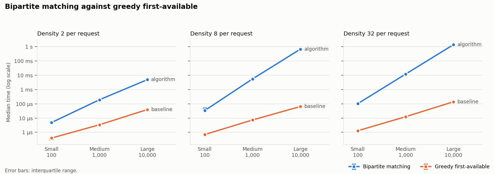 | 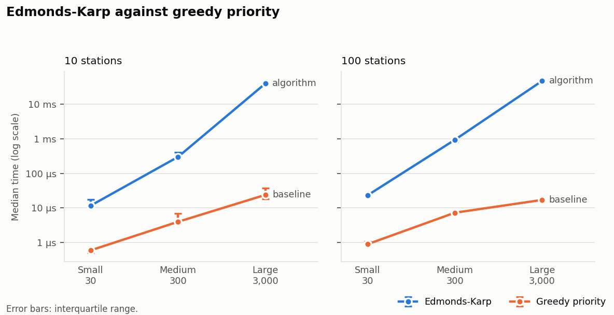 | 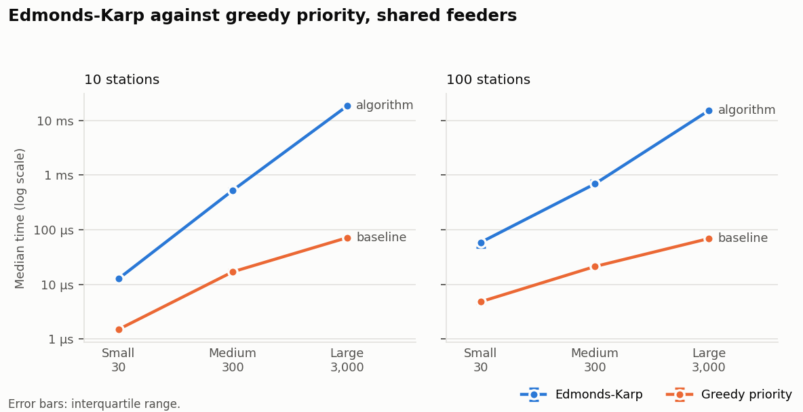 |

| Selection | Range queries |
|---|---|
| 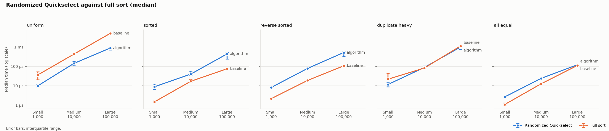 | 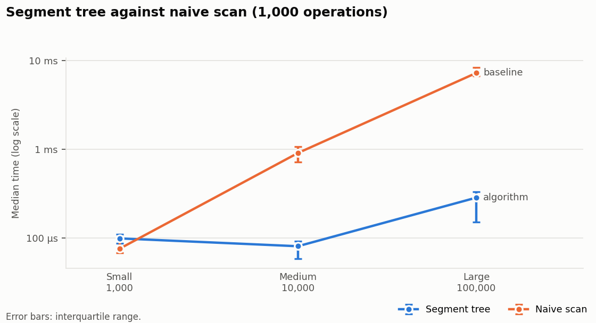 |

Raw exports: [`docs/benchmark-results/`](docs/benchmark-results/). Charts are regenerated by
`scripts/plot_benchmarks.py` from those files only.
</details>

## Architecture

<p align="center">
  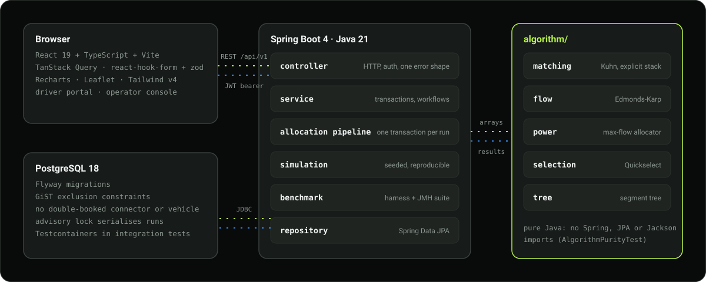
</p>

| Layer | Highlights |
|---|---|
| **Frontend** | React 19, TypeScript, Vite, Tailwind CSS v4, TanStack Query, react-hook-form with zod, Recharts and Leaflet. Lazy-loaded routes and layouts that hold down to phone width. It renders server results and never computes an assignment, allocation, percentile or range aggregate itself |
| **API** | Spring Boot 4.1 on Java 21. JWT bearer authentication with driver and operator roles, BCrypt(12) password hashing, validated request records, and one error shape for every failure |
| **Algorithms** | `matching`, `flow`, `power`, `selection`, `tree`, plus baselines and verifiers. No framework imports, enforced by a test |
| **Simulation** | Seeded scenario generator and slot-by-slot executor. The same seed reproduces the same input hash and every non-timing metric |
| **Benchmarks** | Single-threaded in-application harness plus a JMH suite that times the identical seeded inputs |
| **Database** | PostgreSQL 18 with Flyway migrations, check constraints that mirror the invariants the services rely on, GiST exclusion constraints, and transaction-scoped advisory locks |

**Error contract.** Every error returns `{status, code, message, fieldErrors[], timestamp, path}` with a stable `code`:
`VALIDATION_FAILED`, `NOT_FOUND`, `FORBIDDEN`, `UNAUTHORIZED`, `CONFLICT`, `INPUT_TOO_LARGE`, `INVALID_STATE`,
`METHOD_NOT_ALLOWED`, `UNSUPPORTED_MEDIA_TYPE` or `INTERNAL_ERROR`. Stack traces never reach clients.

## Run it locally

**Prerequisites:** JDK 21, Node.js 20 or newer, Docker with Compose v2. Maven is not required (the Maven Wrapper is
included). Python 3.10+ is only needed for the offline dataset and chart scripts.

```bash
git clone https://github.com/arjun-nair1090/chargewise.git
cd chargewise
cp .env.example .env              # replace every placeholder value
docker compose up -d db           # PostgreSQL 18 on localhost:${CHARGEWISE_DB_PORT:-5432}

cd backend
CHARGEWISE_DEMO_SEED_ON_STARTUP=true ./mvnw spring-boot:run     # http://localhost:8080, loads the demo data
# Windows PowerShell: $env:CHARGEWISE_DEMO_SEED_ON_STARTUP='true'; .\mvnw.cmd spring-boot:run

cd ../frontend
npm ci
npm run dev                       # http://localhost:5173, /api is proxied to the backend
```

Flyway creates the schema on startup. Check `curl http://localhost:8080/api/v1/health`, then sign in at
http://localhost:5173 as `operator@demo.chargewise.test` or `driver01@demo.chargewise.test` with the
`CHARGEWISE_DEMO_PASSWORD` you set in `.env`. Interactive API docs: http://localhost:8080/swagger-ui.html.

**Demo walkthrough.** As the operator, open **Allocation** and press **Run allocation**: on the demo data, 120 eligible
requests become 53 assigned, 67 waitlisted and 0 rejected, each with its reason. Then try the **Shared feeders**
example in the **Algorithm Lab**, a **High contention** simulation, and a benchmark run. As a driver, add a vehicle,
pick a compatible station and request a charging window.

<details>
<summary><b>Environment variables</b></summary>
<br>

All variables live in `.env` (git-ignored). The backend reads `../.env` when started from `backend/`; real environment
variables take precedence.

| Variable | Purpose |
|---|---|
| `POSTGRES_DB`, `POSTGRES_USER`, `POSTGRES_PASSWORD` | Database name and credentials for Docker Compose |
| `CHARGEWISE_DB_PORT` | Host port for PostgreSQL (default `5432`) |
| `CHARGEWISE_DB_URL`, `CHARGEWISE_DB_USER`, `CHARGEWISE_DB_PASSWORD` | Backend JDBC connection; must match the Compose values |
| `CHARGEWISE_JWT_SECRET` | Token signing secret, at least 32 random bytes |
| `CHARGEWISE_BOOTSTRAP_OPERATOR_EMAIL` / `_PASSWORD` | Optional initial operator account |
| `CHARGEWISE_DEMO_PASSWORD` | Password for every `@demo.chargewise.test` account; seeding refuses to run while it is blank |
| `CHARGEWISE_DEMO_SEED_ON_STARTUP` | `true` replaces operational data with `datasets/*.json` at startup (default `false`) |
| `CHARGEWISE_DEMO_DATASET_DIR` | Dataset folder, relative to `backend/` (default `../datasets`) |
| `CHARGEWISE_LIFECYCLE_ENABLED` | `false` stops the 60-second job that advances simulated sessions (default `true`) |
</details>

<details>
<summary><b>Demo data</b></summary>
<br>

`datasets/` holds the demo network: 36 public charging stations across the Mumbai Metropolitan Region and Pune with
78 connectors, 40 vehicles belonging to 20 demo drivers, and 120 charging requests.

- **Stations** (name, operator, location, address) come from [OpenStreetMap](https://www.openstreetmap.org/copyright),
  © OpenStreetMap contributors, ODbL 1.0, with addresses from Nominatim. Connector types and power ratings are taken
  from OSM socket tags where mapped, and from each operator's standard hardware otherwise.
- **Vehicles** use the published specs of EV models sold in India (Tata Nexon.ev, MG Windsor EV, BYD Atto 3, …).
- **Grid limits, demo accounts and charging requests** are generated from the seed: grid limits at 60–100 % of each
  site's charger rating, DC top-ups of 30–90 minutes and AC sessions of 1.5–4 hours.

Request windows are stored as offsets from the next 15-minute boundary, so they are always in the future when loaded.

```bash
python scripts/generate_dataset.py --seed 20261102 --out datasets   # regenerates the same files byte for byte
python scripts/fetch_osm_stations.py                                 # optional: refresh the station snapshot
```

The generator reads the committed snapshot `datasets/sources/osm_charging_stations.json`, so regenerating needs no
network access. Refreshing the snapshot changes the station list, so rerun the generator and update the counts in
`DemoDataSeederIT` afterwards.

Seeding replaces stations, connectors, vehicles, bookings, sessions and allocation runs, and recreates the demo
accounts. Other registered accounts, simulations and benchmark runs are kept.
</details>

<details>
<summary><b>Troubleshooting</b></summary>
<br>

| Symptom | Fix |
|---|---|
| `release version 21 not supported` | Install JDK 21, point `JAVA_HOME` at it, and open a new terminal |
| `port is already allocated` on 5432 | Set `CHARGEWISE_DB_PORT=5433` and the same port in `CHARGEWISE_DB_URL`, then `docker compose up -d db` |
| `Could not find a valid Docker environment` during `./mvnw verify` | Start Docker; the integration tests need it (`./mvnw test` does not) |
| Health shows `"database":"DOWN"` | `docker compose ps`, start the `db` service, and check the credentials in `.env` |
| The UI shows **Backend unreachable** | Start the backend on port 8080 before the frontend |
| `./mvnw: Permission denied` in Git Bash | Run `sh mvnw …`, or `.\mvnw.cmd` from PowerShell |
</details>

## API

All paths are under `/api/v1`. Operator endpoints require an operator token.

| Area | Endpoints |
|---|---|
| Auth | `POST /auth/register`, `POST /auth/login`, `GET /auth/me` |
| Driver | `GET /stations`, `/stations/nearby`, `/stations/{id}/availability`; `GET/POST/PUT /vehicles`; `GET/POST /bookings`, `PATCH /bookings/{id}/cancel`; `GET /sessions/history` |
| Operator | `POST/PUT /operator/stations`, `POST /operator/stations/{id}/connectors`, `PATCH /operator/connectors/{id}/status`; `POST /operator/allocation/run`, `GET /operator/allocation/{id}`; `GET /operator/dashboard`, `/operator/requests`, `/operator/sessions` |
| Algorithm Lab | `POST /algorithms/matching/execute`, `/algorithms/max-flow/execute`, `/algorithms/quickselect/execute`, `/algorithms/segment-tree/query` |
| Evidence | `POST /simulations`, `POST /simulations/{id}/run`, `GET /simulations/{id}/comparison`; `POST /benchmarks/run`, `GET /benchmarks/{id}` |

<details>
<summary><b>Examples</b></summary>
<br>

```bash
# Sign in (the password is CHARGEWISE_DEMO_PASSWORD from .env)
TOKEN=$(curl -s -X POST http://localhost:8080/api/v1/auth/login -H "Content-Type: application/json" \
  -d "{\"email\":\"operator@demo.chargewise.test\",\"password\":\"$CHARGEWISE_DEMO_PASSWORD\"}" | jq -r .accessToken)

# Run allocation: matching, then Edmonds-Karp, in one transaction
curl -X POST http://localhost:8080/api/v1/operator/allocation/run \
  -H "Authorization: Bearer $TOKEN" -H "Content-Type: application/json" -d '{}'

# Algorithm Lab: matching against greedy on your own graph (cardinality 2 against greedy's 1)
curl -X POST http://localhost:8080/api/v1/algorithms/matching/execute \
  -H "Authorization: Bearer $TOKEN" -H "Content-Type: application/json" \
  -d '{"requests":["R1","R2"],"connectors":["C1","C2"],
       "edges":[{"request":"R1","connector":"C1"},{"request":"R1","connector":"C2"},{"request":"R2","connector":"C1"}]}'

# Benchmark every family at three sizes, then poll until status is COMPLETED (about 30 s)
curl -X POST http://localhost:8080/api/v1/benchmarks/run \
  -H "Authorization: Bearer $TOKEN" -H "Content-Type: application/json" \
  -d '{"seed":20261103,"warmups":3,"trials":7,"sizes":["SMALL","MEDIUM","LARGE"]}'
```

The Lab endpoints cap input at 5,000 vertices, 50,000 edges and 1,000,000 values (`413` beyond), and max-flow
capacities at 10^12, so no flow sum can overflow.
</details>

## Testing

<table>
  <tr>
    <td align="center"><h3>186</h3>unit tests</td>
    <td align="center"><h3>85</h3>integration tests<br><sub>Testcontainers PostgreSQL</sub></td>
    <td align="center"><h3>57</h3>frontend tests<br><sub>Vitest + Testing Library</sub></td>
    <td align="center"><h3>64</h3>JMH benchmark cases</td>
  </tr>
</table>

```bash
cd backend
./mvnw test        # unit tests, no Docker needed
./mvnw verify      # unit + integration tests against a real PostgreSQL in Testcontainers

cd ../frontend
npm run typecheck && npm run lint && npm test && npm run build
```

What the suites pin down:

- **Algorithms:** at least ten tests each, covering hand-computed examples, empty and degenerate inputs, invalid
  input, stress cases, and randomized comparison against brute force or the baseline over hundreds of seeded graphs.
- **Mutation-checked guards:** the stack-depth test fails on a recursive matcher, the purity test fails on an injected
  Spring import, and the simulation's "algorithm never loses a slot" pins fail when greedy is swapped in.
- **Concurrency:** concurrent allocation runs serialise; station, connector and cancellation writes wait for a running
  allocation; overlapping bookings are rejected by the database.
- **API contract:** error paths return the documented code and shape, and driver and operator role checks are tested.

<details>
<summary><b>JMH microbenchmarks</b></summary>
<br>

```bash
cd backend
./mvnw -B test-compile dependency:build-classpath -Dmdep.outputFile=target/jmh.classpath -Dmdep.includeScope=test
java -cp "target/test-classes;target/classes;$(cat target/jmh.classpath)" org.openjdk.jmh.Main \
     -rf json -rff target/jmh-result.json
```

Use `:` instead of `;` as the classpath separator on macOS and Linux. Add a class name such as `MatchingBenchmark` to
run one suite, or `-p size=LARGE` to include the Large matching and power cases.
</details>

## Repository layout

```text
chargewise/
├── backend/                 Spring Boot 4 API (Java 21)
│   └── src/main/java/com/chargewise/
│       ├── algorithm/       matching · flow · power · selection · tree   (pure Java)
│       ├── service/         workflows, transactions, the allocation pipeline
│       ├── simulation/      seeded scenario generator and executor
│       ├── benchmark/       in-application harness
│       └── controller/ dto/ entity/ repository/ security/ config/ exception/
├── frontend/                React 19 + TypeScript + Vite
├── datasets/                demo data (JSON): real OSM stations, made-up requests
├── docs/
│   ├── benchmark-results/   exported benchmark runs and JMH results
│   ├── diagrams/            charts drawn from those exports
│   ├── screenshots/         every screen at desktop and phone widths
│   └── readme/              the animations on this page
├── scripts/                 dataset generator and chart plotting (Python)
└── docker-compose.yml       local PostgreSQL
```

## Known limitations

- Each allocation run treats its new sessions as simultaneous when sharing power. That is conservative: it can leave
  power unused between sessions that never overlap, but it never exceeds a limit.
- The matcher does not stop early once every connector is taken, so very dense large graphs cost more than necessary.
  The benchmarks show the measured `O(V·E)` cost, and the early exit is the natural next step.
- Station locations are real, but connectors are partly estimated, grid limits and bookings are made up, and charging
  is simulated. ChargeWise is an academic prototype, not a charger controller.

---

<p align="center">
  <sub>
    Built by <a href="https://github.com/arjun-nair1090">@arjun-nair1090</a> for the Advanced Algorithms course
    (CIA 3), Semester V, 2026–27.
  </sub>
</p>
