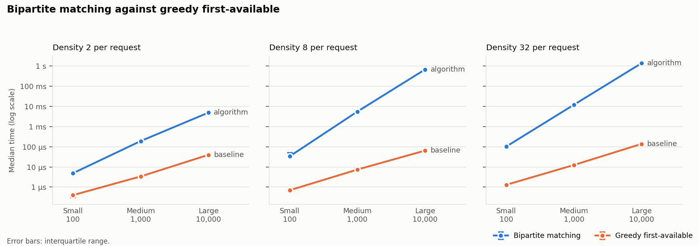
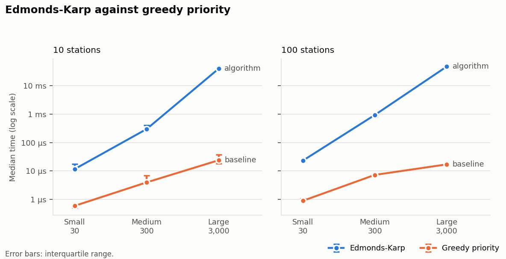
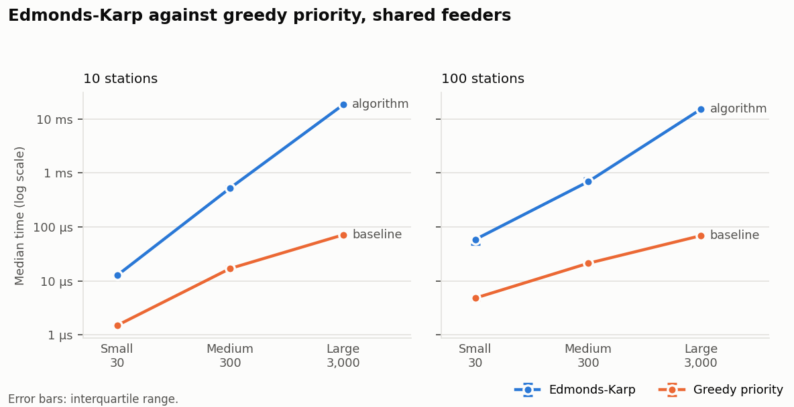
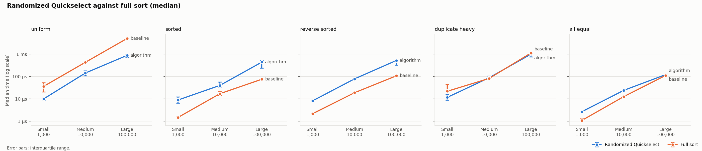
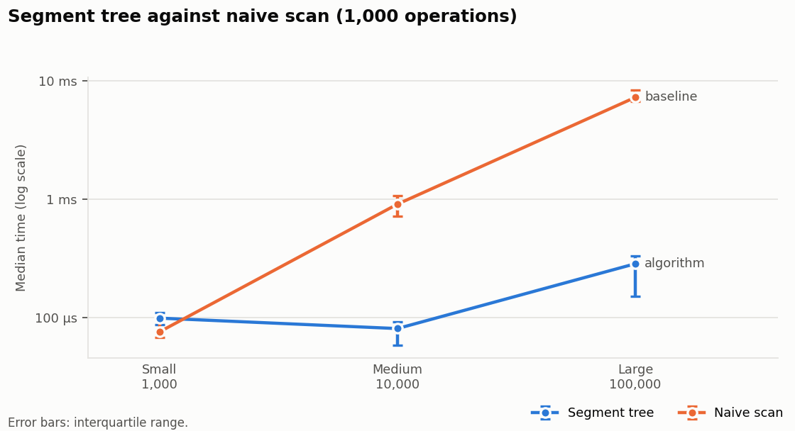

# Benchmark Report

Every number in this report was measured and recorded. Nothing is estimated or copied by hand: the tables come
straight from the exported run files in [`benchmark-results/`](benchmark-results/), and the charts in
[`diagrams/`](diagrams/) are drawn from the same files by `scripts/plot_benchmarks.py`. For the theoretical bounds
these measurements are checked against, see [complexity-analysis.md](complexity-analysis.md).

## 1. What was measured

| Family | Algorithm | Baseline | Quality compared |
|---|---|---|---|
| `MATCHING` | Bipartite matching (DFS augmenting paths) | Greedy first-available | Requests matched |
| `POWER` | Edmonds-Karp on the spec §6.2 network | Greedy priority | Total power allocated |
| `POWER_FEEDERS` | Edmonds-Karp on the D12 shared-feeder network | Greedy priority, feeder-aware | Total power allocated |
| `SELECTION` | Randomized Quickselect (median, `k = ⌊(n−1)/2⌋`) | Full sort, then index | Selected value (must be equal) |
| `RANGE_QUERY` | Segment tree (range sum and range max, point update) | Naive scan | Checksum of all answers (must be equal) |

### Input sizes

| Size | Matching requests × connectors | Power sessions | Selection / range values |
|---|---|---|---|
| Small | 100 × 30 | 30 | 1,000 |
| Medium | 1,000 × 300 | 300 | 10,000 |
| Large | 10,000 × 3,000 | 3,000 | 100,000 |

Within each size:

- **Matching** varies the **density**, meaning how many distinct connectors each request is compatible with, chosen
  uniformly at random: 2, 8 or 32 (capped at the connector count, so Small density 32 is effectively 30).
- **Power** varies the **station count**: 10 or 100. There is one session per connector, each placed on a uniformly
  chosen station. Each station's grid limit is 60% of the combined rating of its connectors, so stations bind.
- **Shared feeders** (D12) are added for `POWER_FEEDERS`. There are a third as many feeders as stations (at least
  two), 40% of stations are dual-fed, and each feeder carries 60% of the limits of the stations it primarily serves.
- **Selection** varies the **distribution**: uniform, sorted, reverse sorted, duplicate-heavy (16 distinct values)
  and all-equal.
- **Range queries** replay **1,000 operations**. One in ten is a point update; the rest alternate range-sum and
  range-max queries.

### Recorded runs

| File | Run | Seed | Families | Sizes | Warm-ups × trials |
|---|---|---|---|---|---|
| `all-sizes-seed-20261103.json` | 5 | 20261103 | all five | Small, Medium, Large | 3 × 7 |
| `selection-feeders-seed-1.json` | 6 | 1 | `SELECTION`, `POWER_FEEDERS` | Small, Medium, Large | 3 × 7 |
| `selection-feeders-seed-2.json` | 7 | 2 | `SELECTION`, `POWER_FEEDERS` | Small, Medium, Large | 3 × 7 |
| `selection-feeders-seed-3.json` | 8 | 3 | `SELECTION`, `POWER_FEEDERS` | Small, Medium, Large | 3 × 7 |
| `jmh-seed-20261103.json` | JMH | 20261103 | all five | see §8 | 3 × 1 s warm-up, 5 × 1 s measured, 1 fork |

Runs 5 to 8 were started from the Benchmarks page of the operator console (`POST /api/v1/benchmarks/run`) and
exported with its **Download JSON** button, which saves the body of `GET /api/v1/benchmarks/{id}`. Run 5 took
27.3 s in total.

**Environment** (as recorded in each file): Java 21.0.13 (Eclipse Adoptium, OpenJDK 64-Bit Server VM), Windows 11
amd64, 16 available processors, maximum heap 7.8 GiB.

## 2. Methodology and timing hygiene

The in-application harness (`com.chargewise.benchmark.BenchmarkRunner`) applies these rules to every case.

- **Same input for both sides.** The algorithm and its baseline run on the identical generated input. Each input is
  derived only from the run seed and the case's identity (`caseSeed(runSeed, family, size, variant)`), so any run can
  be reproduced exactly from its seed.
- **Inputs are built before timing.** Generation is never inside the timed region.
- **Mutated state is reset outside the timer.** Quickselect partitions its array in place, so it gets a fresh copy
  before each run, untimed. The segment tree and the naive array are rebuilt before each replay, because the
  workload's updates change them. The full-sort baseline clones its input inside `SortingSelector.select`, so **its
  times include that copy**.
- **Correctness comes before timing.** Both sides are verified first:
  - matchings with `MatchingVerifier`
  - allocations with `CapacityVerifier`
  - selection against a reference sort
  - range answers by equal checksums

  A case that fails verification is reported without times. **Every recorded case passed.**
- **Warm-ups.** Each side runs untimed 3 times, then is timed 7 times with `System.nanoTime()`.
- **No dead-code elimination.** Every result is written to a `volatile` sink so the JIT cannot discard the work.
- **Statistics.** Median, first and third quartiles, and the interquartile range (IQR = Q3 − Q1), all nearest-rank,
  plus the minimum and maximum. The tables report the median with the IQR in brackets.
- **Work counters.** Alongside time, each algorithm reports its own work:
  - matching: edges examined
  - Edmonds-Karp: residual-edge examinations
  - selection: comparisons

  The baselines report the equivalent where they can.
- **Allocated bytes** come from the HotSpot per-thread allocation counter (`ThreadMXBean.getThreadAllocatedBytes`)
  over one extra, untimed run.

**What these numbers are, and are not.** The in-application figures are wall-clock times measured inside a running
Spring Boot server, on one thread, alongside whatever else the JVM and the machine were doing. They are good for
comparing the two sides of one case on one machine in one run. They are not controlled microbenchmarks: there is no
JVM fork per case, the JIT state carries over between cases, and seven trials give a coarse IQR. The JMH suite (§8)
is the controlled measurement: a forked JVM, timed warm-up iterations and dead-code protection by `Blackhole`. Where
the two disagree, JMH is the one to trust.

## 3. Bipartite matching against greedy first-available



Seed 20261103:

| Size | Density | Edges | Matching median (IQR) | Greedy median (IQR) | Edges examined (matching / greedy) | Matched (matching / greedy) |
|---|---|---|---|---|---|---|
| Small | 2 | 200 | 4.9 µs (300 ns) | 400 ns (100 ns) | 1,330 / 177 | 30 / 30 |
| Small | 8 | 800 | 33.6 µs (17.4 µs) | 700 ns (100 ns) | 17,250 / 626 | 30 / 30 |
| Small | 32 | 3,000 | 102 µs (7.2 µs) | 1.3 µs (100 ns) | 70,060 / 2,565 | 30 / 30 |
| Medium | 2 | 2,000 | 193 µs (48.9 µs) | 3.4 µs (400 ns) | 41,429 / 1,793 | 300 / 299 |
| Medium | 8 | 8,000 | 5.56 ms (1.76 ms) | 7.4 µs (1.6 µs) | 1,696,715 / 6,321 | 300 / 300 |
| Medium | 32 | 32,000 | 12.2 ms (682 µs) | 12.5 µs (300 ns) | 6,758,794 / 23,395 | 300 / 300 |
| Large | 2 | 20,000 | 4.93 ms (1.03 ms) | 39.8 µs (9.5 µs) | 722,188 / 17,915 | 2,998 / 2,997 |
| Large | 8 | 80,000 | 680 ms (16.8 ms) | 64.8 µs (1.2 µs) | 168,251,786 / 62,805 | 3,000 / 3,000 |
| Large | 32 | 320,000 | 1.4 s (111 ms) | 140 µs (16.9 µs) | 672,976,123 / 234,319 | 3,000 / 3,000 |

**Quality.** On these uniformly random graphs, greedy is very close to optimal. It falls short by one request at
Medium and Large density 2, and matches the maximum everywhere else. The matcher's guarantee matters on structured
contention, where an early request takes the only connector a later request could use. The Algorithm Lab's
constructed example shows that case: 2 matched against greedy's 1. Random uniform graphs rarely contain it, and this
report does not claim otherwise.

**Cost, and where it comes from.** The matcher is `O(L·(R + E))` (complexity-analysis §1). At densities 8 and 32
the measured edge examinations come to 20–23% of `L·(R + E)` at every size:

- 168.3 M of 830 M at Large density 8
- 673.0 M of 3.23 G at Large density 32

The counters also fit a simple model: `(L − R) · R · d`, where `d` is the density.

- Large density 8: 7,000 × 3,000 × 8 = 168.0 M (measured 168.3 M)
- Large density 32: 672.0 M (measured 673.0 M)
- Medium: within 1%

What this means: once the matching has used every connector, each of the `L − R` remaining requests can only fail.
Yet each of those failing searches still walks the whole alternating tree, about `R · d` edges. At density 2 the graph
breaks into small components, so a failing search stops early: 722 K examinations at Large.

**Future work, not implemented: early exit.** A matching can never be larger than `min(L, R)`. Stopping the
augmenting loop as soon as the matching reaches that size would skip those doomed searches without changing the
result. By the model above, that is nearly all of the work at Large density 8 and 32. Hopcroft-Karp, at
`O(E·√V)`, is the general improvement. Neither is implemented. The 1.4 s at Large density 32 is the cost of the
plain `O(V·E)` algorithm at a size the live system never reaches: one allocation run in the demo handles around a
hundred requests (115 eligible in the Phase 5 check, [test-report.md](test-report.md)).

## 4. Edmonds-Karp against greedy priority



### 4.1 Spec §6.2 network (direct model)

Seed 20261103:

| Size | Stations | Sessions | Edmonds-Karp median (IQR) | Greedy median (IQR) | Operations (EK / greedy) | Allocated kW (EK / greedy) | Violations |
|---|---|---|---|---|---|---|---|
| Small | 10 | 30 | 11.7 µs (6 µs) | 600 ns (100 ns) | 2,063 / 30 | 802.21 / 802.21 | 0 / 0 |
| Small | 100 | 30 | 23.1 µs (600 ns) | 900 ns (200 ns) | 4,459 / 30 | 836.14 / 836.14 | 0 / 0 |
| Medium | 10 | 300 | 298 µs (110 µs) | 4 µs (3.4 µs) | 98,541 / 300 | 8,487.44 / 8,487.44 | 0 / 0 |
| Medium | 100 | 300 | 926 µs (232 µs) | 7.3 µs (1 µs) | 150,270 / 300 | 7,244.66 / 7,244.66 | 0 / 0 |
| Large | 10 | 3,000 | 39 ms (1.5 ms) | 23.9 µs (19.4 µs) | 13,172,226 / 3,000 | 83,243.71 / 83,243.71 | 0 / 0 |
| Large | 100 | 3,000 | 46.5 ms (7.6 ms) | 17.1 µs (1.1 µs) | 13,453,335 / 3,000 | 83,432.75 / 83,432.75 | 0 / 0 |

**The predicted tie, now measured.** On the spec's network, every session hangs off exactly one station, so the
network is a tree. [algorithms.md §2](algorithms.md) shows that work-conserving greedy then reaches the maximum total
too. The measurements agree: **the totals are identical in all six cases**, to the watt. The unit test
`equalsGreedyTotalOnTreeShapedModel` already pinned this on 200 seeded problems; here it holds at sizes up to 3,000
sessions.

On this model, Edmonds-Karp does not deliver more power. At Large it takes about 1,600× to 2,700× as long as
greedy (39 ms against 23.9 µs, and 46.5 ms against 17.1 µs). What it buys is three things:

- the min-cut certificate, which proves no allocation could do better
- the per-constraint bottleneck diagnosis
- correctness when the model generalises, which §4.2 measures

### 4.2 Shared feeders (D12)



Seed 20261103:

| Size | Stations | Sessions | Edmonds-Karp median (IQR) | Greedy median (IQR) | Operations (EK / greedy) | Allocated kW (EK / greedy) | Violations |
|---|---|---|---|---|---|---|---|
| Small | 10 | 30 | 12.7 µs (600 ns) | 1.5 µs (100 ns) | 2,266 / 62 | 722.09 / 701.23 | 0 / 0 |
| Small | 100 | 30 | 58.5 µs (13.8 µs) | 4.8 µs (500 ns) | 5,699 / 58 | 532.66 / 530.43 | 0 / 0 |
| Medium | 10 | 300 | 527 µs (55.2 µs) | 17 µs (1.7 µs) | 79,926 / 516 | 6,464.45 / 6,464.45 | 0 / 0 |
| Medium | 100 | 300 | 689 µs (148 µs) | 21.2 µs (1.9 µs) | 126,580 / 534 | 5,324.70 / 5,318.75 | 0 / 0 |
| Large | 10 | 3,000 | 18.4 ms (1.22 ms) | 71.4 µs (1.9 µs) | 6,188,659 / 5,150 | 61,471.51 / 61,471.51 | 0 / 0 |
| Large | 100 | 3,000 | 15.3 ms (1.05 ms) | 69.1 µs (8.2 µs) | 4,419,001 / 5,297 | 62,812.15 / 62,812.15 | 0 / 0 |

Across all four seeds:

| Seed | Case | EK kW | Greedy kW | EK gain |
|---|---|---|---|---|
| 20261103 | Small, 10 stations | 722.09 | 701.23 | +20.86 kW (+2.97%) |
| 20261103 | Small, 100 stations | 532.66 | 530.43 | +2.22 kW (+0.42%) |
| 20261103 | Medium, 10 stations | 6,464.45 | 6,464.45 | tie |
| 20261103 | Medium, 100 stations | 5,324.70 | 5,318.75 | +5.95 kW (+0.11%) |
| 20261103 | Large, 10 stations | 61,471.51 | 61,471.51 | tie |
| 20261103 | Large, 100 stations | 62,812.15 | 62,812.15 | tie |
| 1 | Small, 10 stations | 583.71 | 544.65 | +39.06 kW (+7.17%) |
| 1 | Small, 100 stations | 569.95 | 569.95 | tie |
| 1 | Medium, 10 stations | 6,219.14 | 6,219.14 | tie |
| 1 | Medium, 100 stations | 6,286.80 | 6,169.70 | +117.09 kW (+1.90%) |
| 1 | Large, 10 stations | 60,272.21 | 60,272.21 | tie |
| 1 | Large, 100 stations | 61,968.02 | 61,968.02 | tie |
| 2 | Small, 10 stations | 624.60 | 624.60 | tie |
| 2 | Small, 100 stations | 440.12 | 440.12 | tie |
| 2 | Medium, 10 stations | 6,336.94 | 6,336.94 | tie |
| 2 | Medium, 100 stations | 5,870.75 | 5,755.52 | +115.23 kW (+2.00%) |
| 2 | Large, 10 stations | 63,421.06 | 63,421.06 | tie |
| 2 | Large, 100 stations | 59,758.13 | 59,758.13 | tie |
| 3 | Small, 10 stations | 668.77 | 649.90 | +18.87 kW (+2.90%) |
| 3 | Small, 100 stations | 472.67 | 468.23 | +4.44 kW (+0.95%) |
| 3 | Medium, 10 stations | 6,204.31 | 6,204.31 | tie |
| 3 | Medium, 100 stations | 5,782.17 | 5,776.59 | +5.58 kW (+0.10%) |
| 3 | Large, 10 stations | 61,741.22 | 61,741.22 | tie |
| 3 | Large, 100 stations | 63,199.37 | 63,199.37 | tie |

**The gain depends on the input.**

- **EK finishes ahead in 9 of 24 cases**, by 0.10% to 7.17%, and is **never below greedy**. That `EK ≥ greedy`
  bound is the only guarantee; `randomFeederProblemsEkNeverBelowGreedy` checks it on 200 seeded problems.
- **Medium with 100 stations** is the one case EK won under all four seeds.
- **Every Large case tied.** The recorded outcomes suggest why. In every seed EK reports exactly as many
  bottlenecks as there are feeders (3 with 3 feeders, 33 with 33). That is consistent with a minimum cut made of the
  feeder edges alone. If so, the deliverable total is simply the sum of feeder capacities, and greedy fills every
  feeder too.
- **Gains appear only where feeders bind unevenly.** Some feeders saturate while a dual-fed station's other feeder
  still has room. That is exactly the stranding pattern in `feederRoutingBeatsFixedOrderGreedy`.
- **The feeder share was chosen to show this.** At a 40% share every feeder saturates under both allocators and they
  always tie; at 100% feeders stop binding. That probe is recorded in [architecture.md §16](architecture.md).

## 5. Randomized Quickselect against full sort



Seed 20261103, median of `n` values. The other seeds are in §5.1.

| Size | Distribution | Quickselect median (IQR) | Full sort median (IQR) | Comparisons | Comparisons / n |
|---|---|---|---|---|---|
| Small | uniform | 10 µs (2.7 µs) | 36.3 µs (32 µs) | 2,975 | 2.98 |
| Small | sorted | 9 µs (5.9 µs) | 1.5 µs (300 ns) | 3,376 | 3.38 |
| Small | reverse sorted | 8.3 µs (1.6 µs) | 2.2 µs (300 ns) | 3,282 | 3.28 |
| Small | duplicate heavy | 11.8 µs (6.5 µs) | 22.1 µs (22.5 µs) | 2,584 | 2.58 |
| Small | all equal | 2.7 µs (100 ns) | 1.1 µs (300 ns) | 1,000 | 1.00 |
| Medium | uniform | 144 µs (73 µs) | 434 µs (25.2 µs) | 36,894 | 3.69 |
| Medium | sorted | 40.4 µs (23 µs) | 17.2 µs (7 µs) | 32,353 | 3.24 |
| Medium | reverse sorted | 79 µs (7.4 µs) | 19 µs (2.2 µs) | 37,621 | 3.76 |
| Medium | duplicate heavy | 88.7 µs (26.3 µs) | 82.7 µs (16.4 µs) | 25,522 | 2.55 |
| Medium | all equal | 24.2 µs (800 ns) | 12.7 µs (1 µs) | 10,000 | 1.00 |
| Large | uniform | 892 µs (272 µs) | 5.08 ms (264 µs) | 277,807 | 2.78 |
| Large | sorted | 442 µs (294 µs) | 75.9 µs (4.4 µs) | 355,816 | 3.56 |
| Large | reverse sorted | 525 µs (241 µs) | 108 µs (7.3 µs) | 262,232 | 2.62 |
| Large | duplicate heavy | 1 ms (337 µs) | 1.13 ms (63.5 µs) | 281,146 | 2.81 |
| Large | all equal | 122 µs (8.1 µs) | 112 µs (5.7 µs) | 100,000 | 1.00 |

**Linear in practice.** Expected `O(n)` (complexity-analysis §3) shows up directly in the work counter. Comparisons
per element stay between 2.2 and 4.4 at every size, for every distribution except all-equal, across all four seeds.
They scatter around the classic expected bound for the median, `2(1 + ln 2) ≈ 3.39` comparisons per element.
All-equal input costs exactly `n` comparisons (1.00 per element): the three-way partition puts every element in the
middle band in one pass.

**Where Quickselect wins: uniform input.** At Large it beats the sort by 4.7× to 5.7× in all four seeds (892 µs to
1.02 ms, against 4.79 ms to 5.2 ms).

**Where it loses: presorted input.** On sorted and reverse-sorted input the full sort is 3.9× to 5.9× faster at
Large:

- sorted: 72.2 µs to 123 µs for the sort, against 426 µs to 482 µs for Quickselect
- reverse sorted: 103 µs to 108 µs for the sort, against 414 µs to 539 µs for Quickselect

The JDK's `Arrays.sort(long[])` adapts to existing order: on larger arrays it detects and merges sorted runs, so a
sorted or reversed array costs it close to one linear pass. Quickselect's random pivots, which protect it from
adversarial input, cannot exploit order that is already there: its comparison count on sorted input (3.56 per element
at Large) is no lower than on uniform input (2.78).

**Duplicate-heavy input** goes to Quickselect at Large in every seed, by 1.13× to 1.64× (§5.1). JMH reverses it, with
the sort 1.1× ahead and the two intervals overlapping (§8), so treat this case as close with no settled winner.
**All-equal input** goes to the sort in every seed, by 1.09× to 1.88×, and by 1.4× under JMH. Both are linear there:
Quickselect's three-way partition finishes in one pass and the JDK sort sees a single run, whose pass is cheaper.

This loss does not touch the product: the price-band input Quickselect serves in ChargeWise
([algorithms.md §3](algorithms.md)) is unordered. But it is a real result, and the report keeps it.

**Allocation.** Quickselect allocated **40 bytes** per run at every size: the result record. The sort allocated
8,056 B, 80,056 B and 800,056 B at Small, Medium and Large, which is its defensive copy of `n` longs plus a small
header. These are bytes allocated during one run, **not peak residency**. They say nothing about how much of that
memory was live at once, or about garbage-collection cost.

### 5.1 Selection at Large across seeds

| Distribution | Seed 20261103 (Quickselect / sort) | Seed 1 | Seed 2 | Seed 3 |
|---|---|---|---|---|
| uniform | 892 µs / 5.08 ms | 986 µs / 4.79 ms | 970 µs / 5.2 ms | 1.02 ms / 4.84 ms |
| sorted | 442 µs / 75.9 µs | 426 µs / 72.2 µs | 435 µs / 73.5 µs | 482 µs / 123 µs |
| reverse sorted | 525 µs / 108 µs | 471 µs / 105 µs | 414 µs / 107 µs | 539 µs / 103 µs |
| duplicate heavy | 1 ms / 1.13 ms | 848 µs / 1.15 ms | 778 µs / 1.28 ms | 898 µs / 1.14 ms |
| all equal | 122 µs / 112 µs | 120 µs / 71.2 µs | 166 µs / 88.4 µs | 124 µs / 76.5 µs |

Small and Medium cases for seeds 1 to 3 are in the exported files and follow the same pattern. Sort wins on sorted,
reverse-sorted and all-equal input at every size. Quickselect wins on uniform input from Medium upward.

## 6. Segment tree against naive scan



Seed 20261103, 1,000 operations per replay (900 queries, 100 point updates):

| Size | n | Segment tree median (IQR) | Naive scan median (IQR) | Per operation (tree / naive) |
|---|---|---|---|---|
| Small | 1,000 | 99.6 µs (23.3 µs) | 76.3 µs (32.6 µs) | 100 ns / 76 ns |
| Medium | 10,000 | 81.3 µs (33.4 µs) | 910 µs (365 µs) | 81 ns / 910 ns |
| Large | 100,000 | 286 µs (184 µs) | 7.24 ms (1.66 ms) | 286 ns / 7.24 µs |

- **Scaling.** The naive scan grows linearly with `n`: 76 ns, 910 ns and 7.24 µs per operation, a factor of about 10
  per tenfold step. The tree stays within a few hundred nanoseconds. In this run that made it **11× faster at Medium
  and 25× at Large**. This is `O(n)` against `O(log n)` per query (complexity-analysis §4).
- **Correction from JMH (§8).** In this run, the naive scan's median beat the tree at Small (n = 1,000), with
  overlapping quartile ranges. Also, the tree's Small median sat *above* its Medium median, so its per-operation
  time fell as `n` grew, which no property of the tree explains. The controlled JMH measurement does not reproduce
  either effect. There the tree costs 39 ns, 59 ns and 90 ns per operation, and is 2.1×, 14× and 89× faster than the
  naive scan. **Use the §8 figures for this family.**
- **Allocation.** Neither side allocated anything during a replay (0 bytes). Both work on structures built before
  the timed region.

## 7. Spread and its caveats

- **IQR as a share of the median varies widely.** It runs from about 2% (greedy matching at Large density 8:
  1.2 µs on 64.8 µs) to nearly 90% (full sort on Small uniform input: 32 µs on 36.3 µs).
- **Sub-microsecond medians are close to the timer's resolution.** The harness's `System.nanoTime()` readings on this
  machine come in 100 ns steps. Every IQR of "100 ns" or "0 ns" in the tables is one or zero ticks. Treat medians
  under about 2 µs as an order of magnitude, not a value.
- **Overlap.** Where the two sides' quartile ranges overlap, the Benchmarks page adds "Spreads overlap" under the
  faster side's name: the gap between the medians is within the noise. In run 5 that happens in two cases, Medium
  duplicate-heavy selection and Small range queries. Neither of those two "wins" should be read as one.
- **Single run per seed.** Each case was run once per seed, with 7 trials. The four-seed tables in §4.2 and §5.1 show
  the variation between inputs; they are not repeated measurements of one input.

## 8. JMH microbenchmarks

The JMH suite (`backend/src/test/java/com/chargewise/benchmark/jmh/`) times the **same seeded inputs**: it calls the
same `BenchmarkInputs` generators with the same `caseSeed` derivation and the same run seed, 20261103.

**Settings.** Average time per call; 1 forked JVM per benchmark; 3 warm-up iterations of 1 s; 5 measured iterations
of 1 s. JMH reports each score with a 99.9% confidence interval.

**Recorded.** `jmh-seed-20261103.json`, Java 21.0.13+9-LTS, 9 min 1 s in total.

**Scope.** The matching and power suites stop at Medium by default, so a full run stays within minutes. Their Large
cases are covered by the in-application run above. Pass `-p size=LARGE` to include them.

**What each call times.**

| Benchmark | One call |
|---|---|
| Matching and power | One solve on a prebuilt input |
| Selection | One median selection on a copy of the input. Both sides pay for exactly one array copy: Quickselect partitions a clone, and the sort clones internally |
| Range queries | One replay of the 1,000-operation workload on a structure built once per trial |

### Matching

| Density | Size | Bipartite matching (±99.9% CI) | Greedy (±99.9% CI) | Matching vs greedy |
|---|---|---|---|---|
| 2 | Small | 4.1 µs ± 280 ns | 235 ns ± 21 ns | 17.3× slower |
| 8 | Small | 31.5 µs ± 1.8 µs | 685 ns ± 40 ns | 46.0× slower |
| 32 | Small | 81.4 µs ± 4.5 µs | 1.6 µs ± 58 ns | 49.7× slower |
| 2 | Medium | 178.9 µs ± 16.0 µs | 3.6 µs ± 81 ns | 49.5× slower |
| 8 | Medium | 4.58 ms ± 116.1 µs | 6.6 µs ± 47 ns | 695.8× slower |
| 32 | Medium | 10.15 ms ± 568.3 µs | 13.8 µs ± 1.2 µs | 736.8× slower |

### Power allocation

| Model | Size | Stations | Edmonds-Karp (±99.9% CI) | Greedy (±99.9% CI) | EK vs greedy |
|---|---|---|---|---|---|
| Direct | Small | 10 | 10.5 µs ± 957 ns | 185 ns ± 18 ns | 56.5× slower |
| Direct | Small | 100 | 19.7 µs ± 2.0 µs | 445 ns ± 5 ns | 44.2× slower |
| Direct | Medium | 10 | 293.6 µs ± 30.4 µs | 1.4 µs ± 46 ns | 207.0× slower |
| Direct | Medium | 100 | 513.1 µs ± 27.7 µs | 1.6 µs ± 186 ns | 322.9× slower |
| Feeders | Small | 10 | 11.4 µs ± 1.1 µs | 671 ns ± 52 ns | 16.9× slower |
| Feeders | Small | 100 | 36.3 µs ± 3.2 µs | 2.2 µs ± 60 ns | 16.4× slower |
| Feeders | Medium | 10 | 242.5 µs ± 17.8 µs | 6.0 µs ± 238 ns | 40.7× slower |
| Feeders | Medium | 100 | 476.3 µs ± 50.0 µs | 6.3 µs ± 431 ns | 76.1× slower |

### Selection

| Distribution | Size | Quickselect (±99.9% CI) | Full sort (±99.9% CI) | Quickselect vs sort |
|---|---|---|---|---|
| uniform | Small | 11.1 µs ± 1.2 µs | 10.5 µs ± 483 ns | 1.1× slower |
| sorted | Small | 5.6 µs ± 318 ns | 494 ns ± 115 ns | 11.3× slower |
| reverse sorted | Small | 5.8 µs ± 867 ns | 812 ns ± 25 ns | 7.1× slower |
| duplicate heavy | Small | 9.0 µs ± 289 ns | 3.8 µs ± 684 ns | 2.4× slower |
| all equal | Small | 565 ns ± 138 ns | 487 ns ± 85 ns | 1.2× slower |
| uniform | Medium | 128.4 µs ± 3.6 µs | 290.9 µs ± 46.4 µs | 2.3× faster |
| sorted | Medium | 95.4 µs ± 93.8 µs | 6.0 µs ± 428 ns | 15.9× slower |
| reverse sorted | Medium | 54.2 µs ± 7.5 µs | 9.6 µs ± 1.0 µs | 5.7× slower |
| duplicate heavy | Medium | 94.6 µs ± 15.7 µs | 45.1 µs ± 7.2 µs | 2.1× slower |
| all equal | Medium | 7.2 µs ± 442 ns | 6.0 µs ± 362 ns | 1.2× slower |
| uniform | Large | 986.3 µs ± 104.6 µs | 4.38 ms ± 273.3 µs | 4.4× faster |
| sorted | Large | 525.0 µs ± 54.2 µs | 58.1 µs ± 14.1 µs | 9.0× slower |
| reverse sorted | Large | 519.3 µs ± 31.0 µs | 115.5 µs ± 7.1 µs | 4.5× slower |
| duplicate heavy | Large | 1.18 ms ± 698.8 µs | 1.04 ms ± 50.7 µs | 1.1× slower (intervals overlap) |
| all equal | Large | 79.8 µs ± 14.9 µs | 55.6 µs ± 4.1 µs | 1.4× slower |

### Range queries (one call = 1,000 operations)

| Size | Segment tree (±99.9% CI) | Naive scan (±99.9% CI) | Tree vs naive |
|---|---|---|---|
| Small | 38.9 µs ± 2.3 µs | 83.2 µs ± 13.3 µs | 2.1× faster |
| Medium | 58.7 µs ± 4.5 µs | 822.4 µs ± 43.4 µs | 14.0× faster |
| Large | 90.3 µs ± 25.3 µs | 8.02 ms ± 581.3 µs | 88.9× faster |

### Where JMH agrees with the in-application run, and where it does not

**Agreement.** On the comparisons that carry a conclusion, the two harnesses point the same way:

- matching and Edmonds-Karp cost orders of magnitude more than their greedy baselines
- Quickselect beats the sort on uniform input from Medium upward
- the sort beats Quickselect on sorted and reverse-sorted input at every size
- the two are close on duplicate-heavy input at Large

Where both measured the same case, the absolute values agree within about 25% for matching and for the Large
selection and naive-scan cases. Examples:

| Case | JMH | In-application |
|---|---|---|
| Medium density-8 matching | 4.58 ms | 5.56 ms |
| Large uniform Quickselect | 986 µs | 892 µs |
| Large naive scan | 8.02 ms | 7.24 ms |

Medium Edmonds-Karp agrees less well:

| Case | JMH | In-application |
|---|---|---|
| Direct, 10 stations | 294 µs | 298 µs |
| Direct, 100 stations | 513 µs | 926 µs |
| Feeders, 10 stations | 243 µs | 527 µs |

None of these differences changes which side is faster.

**Disagreement: the segment tree.** In the in-application run the tree took 99.6 µs, 81.3 µs and 286 µs per replay.
JMH measures 38.9 µs, 58.7 µs and 90.3 µs. The JMH numbers grow with `n` as `O(log n)` predicts: 39 ns, 59 ns and
90 ns per operation. Two findings from §6 do not survive:

- The naive scan winning at Small was an artefact of the in-server harness, and its quartile ranges overlapped.
  Under JMH the tree is **2.1× faster even at n = 1,000**.
- At Large the tree's advantage is **89×**, not 25×.

The likely cause is the in-server harness's short, interleaved measurement of a call that is only tens of
microseconds long, but this was not investigated further. For the range-query family, the JMH figures are the ones
this report relies on.

**Small greedy and sort cases.** Several of these are faster under JMH than the 100 ns timer steps of the
in-application run can resolve. For example, power greedy at Small runs in 185 ns under JMH.

## 9. Reproducing these results

In-application, from the operator console: open **Benchmarks**, enter the seed, choose the sizes and algorithms,
and press **Run benchmark**. Then use **Download JSON**. The same through the API:

```bash
curl -X POST http://localhost:8080/api/v1/benchmarks/run -H "Authorization: Bearer $TOKEN" \
     -H "Content-Type: application/json" \
     -d '{"seed":20261103,"warmups":3,"trials":7,"sizes":["SMALL","MEDIUM","LARGE"]}'
curl http://localhost:8080/api/v1/benchmarks/{id} -H "Authorization: Bearer $TOKEN" > benchmark.json
```

Charts are drawn from exported files:

```bash
python scripts/plot_benchmarks.py docs/benchmark-results/all-sizes-seed-20261103.json --out docs/diagrams
```

The charts in this report plot run 5 only, so that every point comes from one seed and one run. Passing several
files merges them: each point becomes the median of the runs' medians, and the chart says how many runs it combines.

JMH, from `backend/`:

```bash
./mvnw -B test-compile dependency:build-classpath -Dmdep.outputFile=target/jmh.classpath -Dmdep.includeScope=test
java -cp "target/test-classes;target/classes;$(cat target/jmh.classpath)" org.openjdk.jmh.Main \
     -rf json -rff ../docs/benchmark-results/jmh-seed-20261103.json
```

Use `;` as the classpath separator on Windows and `:` elsewhere.
